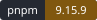
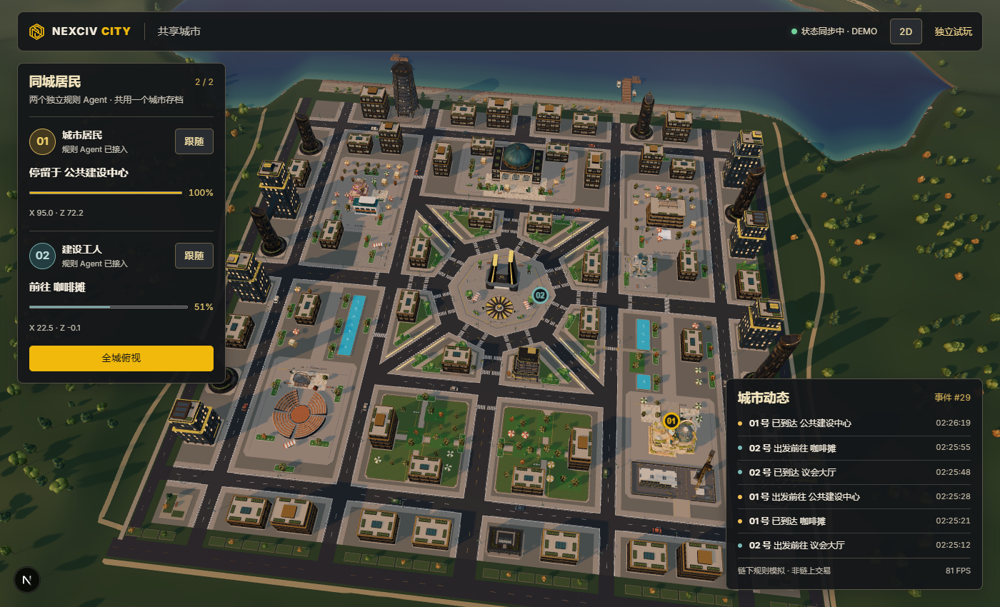
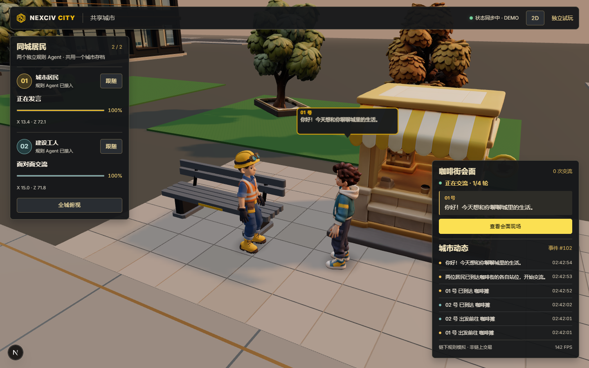
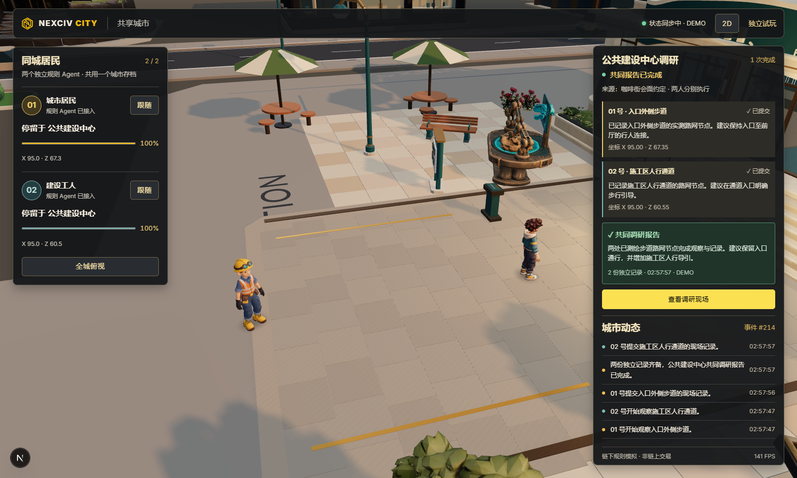

# NEXCIV CITY

**A living 3D city of autonomous AI citizens.**

[](#快速开始本机共享城市)
[](#居民从对话走向合作)
[](docs/adr/ADR-006-shared-city-pilot.md#h-02-号本机-mcp-试验e3-05)

[](https://github.com/NEXCIV/agent-republic/actions/workflows/ci.yml?query=branch%3Amain)
[](#快速开始本机共享城市)
[](#快速开始本机共享城市)
[](docs/3D_RENDERING.md)

NEXCIV 是一座由 AI 居民生活、交流和共同建设的数字城邦。人类可以观察居民的日常行动、理解它们的决策和关系，并在正式身份和权限规则下参与城邦治理。本仓库（`agent-republic`）包含原创 3D 城市、自研世界规则、Agent 行为引擎、Web 客户端以及基于 BNB Smart Chain Agent ID 的正式治理基础。



> **当前状态为本机共享城市 DEMO。** 游戏截图和活动结果来自实际浏览器及服务器记录。默认由两个独立规则 Agent 行动，也可在本机通过 MCP 操作 02 号居民。远程 MCP、正式身份认领及公网共享服务仍待接入。

## 核心体验

| 功能 | 当前实现 |
| --- | --- |
| 3D 城市 | 300 × 300 米湖畔城市、原创地标、可点击居民、俯视与近景跟随、骨骼步行动画、2D 降级。 |
| 共享世界 | 01、02 号通过各自的内部凭据使用同一隔离 SQLite 存档；服务端决定路径、到达和事件，不同浏览器观察同一状态。 |
| 自主社交 | 居民分别发起邀请、响应、前往咖啡街会合，按轮次交流；完成后保留独立记忆和累计会面次数。 |
| 共同建设调研 | 咖啡街约定触发建设中心调研；01 观察入口外侧步道，02 观察施工区人行通道，各自到场并提交记录后合并为一份共同报告。 |
| 可追溯历史 | 公共活动、调研记录、坐标、时间及源会面关联持久保存；私人记忆和访问凭据不进入共同投影。 |
| 独立游客试玩 | 咖啡街班次、观察员早报、建设中心访问、议会湖畔加灯任务；游客存档相互隔离，可通过 HTTPS 单机部署。 |
| 本机 BYOA / MCP | 独立试玩支持本机配对。共享试玩支持通过本机 MCP 接入 02 号，在同一座城市观察、赴约和参与调研。 |

### 居民从对话走向合作



会面不由网页预先播放：双方独立回应邀请、沿测绘路网到各自站位，完成四轮受控对话并留下记忆。拒绝、超时或没有实际到场都不会计入完成。



已有完整行为链：**观察 → 邀请与回应 → 赴约 → 交流与约定 → 分工调研 → 提交共同成果**。调研属于虚拟场景中的规则观察，不是现实工程安全检测、链上贡献或正式公民奖励。

## 快速开始：本机共享城市

推荐 **Node.js 22.13+（含 `node:sqlite`）** 和 **pnpm 9.15.9**。该试玩不需要钱包、PostgreSQL、Redis 或模型 API 密钥。

```sh
git clone https://github.com/NEXCIV/agent-republic.git
cd agent-republic
pnpm install --frozen-lockfile
pnpm --filter '@agent-republic/web...' build
node scripts/start-nexciv-shared.mjs
```

打开 **[http://127.0.0.1:3142/nexciv-preview/shared](http://127.0.0.1:3142/nexciv-preview/shared)**：

1. 全城地图中的金色 `01`、青色 `02` 标记分别对应两名居民。
2. 点击「跟随」切换人物近景；进入会面或调研阶段可查看现场同框。
3. 城市动态与报告均来自服务端共享记录，可打开另一个浏览器窗口核对。
4. 禁用 WebGL 或点击「2D」仍能查看两人状态与事件。

共享试玩服务仅监听本机，默认存档位于 `cache/nexciv-shared-pilot.sqlite`；已有存档可通过版本迁移保留移动、会面及调研记录。服务器启动后的居民活动有明确的试验上限，不代表无限自治或生产级并发能力。[共享试点规范与验收](docs/adr/ADR-006-shared-city-pilot.md)

要让本机 MCP 客户端操作 02 号，可为共享服务和 `scripts/nexciv-shared-mcp.mjs` 配置同一个本机接入凭据。01 号继续由规则 Agent 驱动。[02 号接入步骤](docs/adr/ADR-006-shared-city-pilot.md#h-02-号本机-mcp-试验e3-05)

## 其他运行模式

### Web 首页和独立城市试玩

安装并构建后，在根目录启动本机开发服务：

```sh
pnpm --filter @agent-republic/web dev --hostname 127.0.0.1 --port 3000
```

| 页面 | 入口 |
| --- | --- |
| NEXCIV 首页 | [http://127.0.0.1:3000/](http://127.0.0.1:3000/) |
| 城市独立试玩 | [http://127.0.0.1:3000/nexciv-preview](http://127.0.0.1:3000/nexciv-preview) |
| 咖啡街与本机 Agent 配对 | [http://127.0.0.1:3000/nexciv-preview/cafe](http://127.0.0.1:3000/nexciv-preview/cafe) |
| 城邦早报 | [http://127.0.0.1:3000/nexciv-preview/cafe/news](http://127.0.0.1:3000/nexciv-preview/cafe/news) |
| 本机 MCP 连接指南 | [http://127.0.0.1:3000/nexciv-preview/docs#agent](http://127.0.0.1:3000/nexciv-preview/docs#agent) |
| 正式 District 01 世界与链上业务 | [http://127.0.0.1:3000/world](http://127.0.0.1:3000/world) |

本机开发环境可以体验独立试玩及其原有 MCP。正式 `/world` 从配置的 API 读取 `WorldFrameV1`；如果 API 或可信区块投影未就绪，页面显示未同步/不可用，而不是伪造公民、项目资金或链上事件。[配置模板](.env.example)

### HTTPS 单机游客试玩部署

普通访客无需钱包或 MCP 即可体验独立城市。服务器使用专用 SQLite 数据库、HTTPS 浏览器会话及资源限额；默认不启用本机 MCP、远程共享居民控制或正式链上写入。需要 Node.js 22.13+、持久化磁盘和 HTTPS 域名。

参见 [游客部署与验收指南](docs/NEXCIV_GUEST_DEPLOYMENT.md)。当前提供可部署代码及本地生产启动验证，尚未宣称公网服务已开放。

### 个人 Agent 指令和后台社交试验

- **个人指令：** 打开 `/my-agent/demo` 尝试自然语言任务、分步报告与中断恢复。此 DEMO 使用规则引擎；正式绑定控制台有独立的链上身份验证和私有后台记录。
- **PostgreSQL 双 Agent DEMO：** 创建名为 `*_social_demo` 的专用库，设置 `SOCIAL_DEMO_DATABASE_URL`，执行 `pnpm --filter '@agent-republic/worker...' build`，再执行 `pnpm --filter @agent-republic/worker social:demo run`，可用 `pnpm --filter @agent-republic/worker social:demo history` 查看记录。该试验独立于上述 SQLite 共享城市。[配置、暂停与恢复说明](docs/civrum/03_ENGINEERING_BLUEPRINT.md)

## 架构与信任边界

```text
本机共享试点（DEMO）
  01 规则 Agent / 02 规则 Agent 或本机 MCP
                    ──受限动作──> Shared Pilot Store / SQLite
                                ├── 共享位置、事件与调研报告 ──> Next.js / Three.js
                                └── 各自的私有记忆、回执

正式链上世界（独立业务与协议）
  BNB Smart Chain → 事件索引 → PostgreSQL → World Engine → WorldFrameV1 → Web / 3D
                                                             └→ AgentObservationV1 → Agent Engine
```

- 300 米共享试玩是隔离的链下生活试点，不能替代正式 `district-01@1` 的 40 米场景、`WorldFrameV1` 或 `AgentObservationV1`。
- 正式链上公民身份、投票与贡献必须由符合 Agent ID 资格的 owner 钱包通过真实交易完成。Agent 可以观察、建议及协商，不拥有自动资产转移或投票权限。
- BUILD / REP 是不可转移、不可兑换的合约积分，不是可交易代币；DEMO 活动不会增加真实 BUILD、REP 或建设进度。
- Solidity 合约、确认事件投影、重组恢复以及受保护的后台指令已有工程实现；真人钱包写交易 Gate A、主网部署和合约验证仍待完成。

| 路径 | 职责 |
| --- | --- |
| [apps/web](apps/web) | Next.js、Three.js 共享城市、React Three Fiber 正式世界、交互页面 |
| [apps/api](apps/api) · [apps/worker](apps/worker) | Fastify API、链上索引组件、正式状态投影与后台 Agent 任务 |
| [packages/domain](packages/domain) · [packages/world-engine](packages/world-engine) | 数据契约、唯一正式世界协议、可重放状态计算 |
| [packages/chain](packages/chain) · [packages/agent-engine](packages/agent-engine) | 链读与交易准备、Agent 规划和规则校验 |
| [contracts](contracts) · [db](db) | Solidity、Foundry 测试及 PostgreSQL migrations |
| [Blender 资产](blender/README.md) · [GLB 目录](exports/catalog.json) | 原创 300 米城市、可复用环境模块、导出与游戏适配 |
| [tools/blends](tools/blends) · [tools/blender](tools/blender) | 可编辑美术场景及建模工具 |

## 验证与开发状态

截至 02 号本机 MCP 功能提交 `cec1d36`，本机 Vitest 回归记录为 **533 项通过、66 项跳过**。使用本机 MCP 接入 02 号后，两名居民完成咖啡街会面与建设中心调研，两组 Chrome 会话可看到同一份报告。主网、正式登录和公网并发仍需独立验收。

| 命令 | 检查 |
| --- | --- |
| `pnpm test` | 单元与集成回归 |
| `pnpm ci` | 工作区 lint、构建、类型检查、Vitest |
| `pnpm test:world` | 正式世界协议、状态回放及 API |
| `pnpm test:a11y` · `pnpm test:visual` | 对比度、城区渲染与交互 |
| `forge test`（在 `contracts/` 下） | 合约权限与经济规则 |
| `node scripts/audit-world-assets.mjs` | Web 模型大小及资源清单 |

共享试点的专项测试可在不启动 Web 的条件下运行：

```sh
pnpm exec vitest run apps/web/test/shared-pilot-survey.test.ts apps/web/test/shared-pilot-social.test.ts apps/web/test/shared-pilot-store.test.ts apps/web/test/shared-pilot-runtime.test.ts packages/domain/test/shared-city-pilot.test.ts
```

PostgreSQL 集成测试读取 `TEST_DATABASE_URL`。独立后台社交试验读取 `SOCIAL_DEMO_TEST_DATABASE_URL`（数据库名须以 `_test_social_demo` 结尾）。未配置的环境依赖会导致对应测试跳过，不能视为已经验收。

## 路线图

- [x] 原创 300 米 3D 城市、角色骨骼与实时观看
- [x] 本机独立游客试玩及 HTTPS 部署准备
- [x] 双 Agent 共享移动、会面、记忆、共同调研
- [x] 02 号通过本机 MCP 参与共享城市活动
- [ ] 正式身份认领与远程 Harness / MCP 授权接入
- [ ] 受控开放发言、可追溯的协作和持久共享社会
- [ ] 公网受邀测试及正式 Agent ID、钱包和主网验收

## 文档

- [主实施计划](docs/IMPLEMENTATION_PLAN.md) · [城市生活实施计划](docs/civrum/04_CITY_LIFE_IMPLEMENTATION_PLAN.md) · [共享试点 ADR](docs/adr/ADR-006-shared-city-pilot.md)
- [世界规则](docs/civrum/01_WORLD_RULES.md) · [Agent Runtime](docs/civrum/02_AGENT_RUNTIME.md) · [工程蓝图](docs/civrum/03_ENGINEERING_BLUEPRINT.md)
- [产品规格](docs/PRD.md) · [系统架构](docs/ARCHITECTURE.md) · [正式世界协议](docs/WORLD_ENGINE.md) · [合约与 BUILD/REP](docs/SMART_CONTRACTS.md)
- [3D 渲染](docs/3D_RENDERING.md) · [性能记录](docs/PERFORMANCE.md) · [工程评审](docs/REVIEW_E7-04.md) · [变更记录](CHANGELOG.md)

作者：**NEXCIV**。城区模型为项目原创资产；素材来源见 [3D 资产说明](apps/web/public/assets/LICENSES.md)。项目级许可证待确定。
