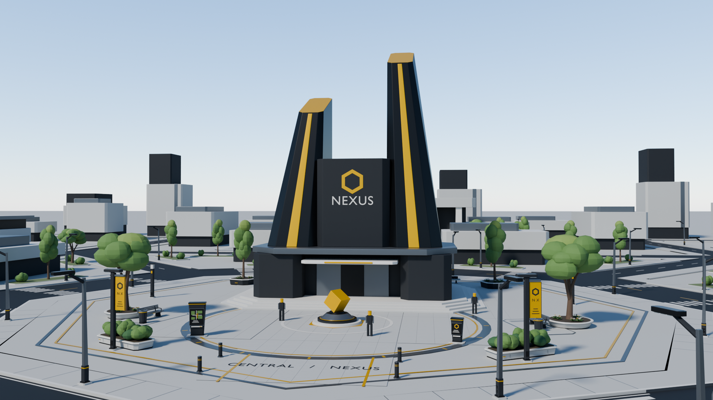
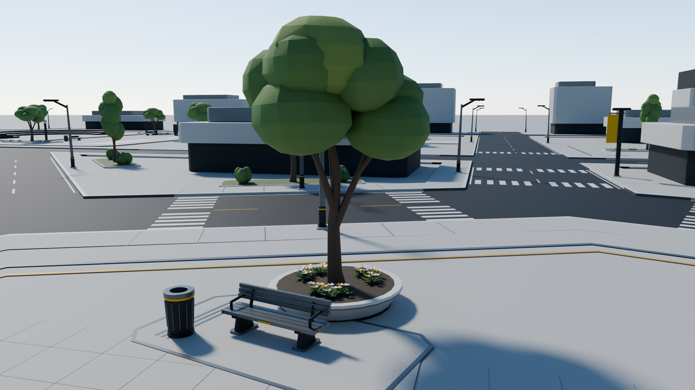

# CIVRUM 环境精修版

作者：NEXCIV。任务：E6-07 性能与美术精修。此目录保存独立的 300 × 300 米城市美术版本，原有灰盒、第二阶段场景和第三阶段导出全部保留。

[Blender 城市场景](blender/CIVRUM_World_Environment.blend) · [公共资产库](blender/CIVRUM_Asset_Library.blend) · [整城 GLB](exports/CIVRUM_City_Environment.glb) · [模块目录](exports/catalog.json)



## 本轮调整

- 三种树木重新制作分枝和扁平冠簇，采用连续的叶面色调及局部折面法线；两种灌木、立体叶片与杯状花瓣保持独立模块。
- 路灯增加灯罩、透镜槽和检修盖；长椅增加支撑、扶手与分离座条；终端增加边框、底座和散热槽；花池增加层叠收边。小型倒角与加权法线已经烘入网格。
- 广场以 1.245 米铺装节距组成原有 10 米模块，保留 9.96 米外廓；前庭采用约 1.23 × 1.02 米错缝石板。板间留 8 毫米缝，原道路接口保持。
- 六种品牌色 HEX 不变，分别调整涂层、金属及混凝土的粗糙度。植物降低色块反差，避免大块亮绿三角面。
- Cycles 使用 1920 × 1080、96 次采样、降噪和 AgX，增加间接光反弹，调整自然天光、柔和日照与阴影。前三张图保留原机位，另加设施近景。



[城市总览](renders/CIVRUM_World_Overview.png) · [同机位街景](renders/CIVRUM_Street_Detail.png) · [原版街景](../../renders/environment/CIVRUM_Street_Detail.png) · [WebGL 预览](renders/webgl/Central_Plaza.png)

## 使用边界

五栋主建筑仍位于 `PLACEHOLDER_BUILDINGS`，保留基底原点、朝向及替换标记。本轮仅为建筑体块增加倒角和材质层次，正式建筑造型与最终人物尚未制作。因此当前画面仍包含大片建筑占位面，不能当作参考图所示的最终城市建筑完成度。

29 种公共设施、绿化及施工资产仍在对应 Collection 中以共享网格摆放。其尺寸和拼接约定见[原资产说明](../../blender/README.md)。近景精修增加了几何量；完整地图采用 GPU 实例化导出。浏览器需支持 `EXT_mesh_gpu_instancing`。正式网页仍使用原有 40 米世界清单，本轮未替换产品场景或业务状态。

## 生成与验证

从仓库根目录执行。生成器要求全新的输出目标，不覆盖已有 `.blend` 或导出目录。`--draft` 只产生预览场景和低采样图片，不生成资产库，不代表完整验收。

```powershell
& 'G:/blender/blender.exe' -b --factory-startup --python-exit-code 1 -P scripts/refine_civrum_world.py -- --output-root art-direction/refined-review --render
& 'G:/blender/blender.exe' -b --factory-startup --python-exit-code 1 -P scripts/export_civrum_world.py -- --world art-direction/refined-review/blender/CIVRUM_World_Environment.blend --output-root art-direction/refined-review
node tests/civrum-environment-webgl.mjs --exports art-direction/refined-review/exports --output art-direction/refined-review/renders/webgl --quality refined
```

检查本目录交付件：

```powershell
& 'G:/blender/blender.exe' -b --factory-startup --python-exit-code 1 -P scripts/refine_civrum_world.py -- --check
& 'G:/blender/blender.exe' -b --factory-startup --python-exit-code 1 -P scripts/export_civrum_world.py -- --output-root art-direction/refined --check
```

几何统计记录在 [refinement.json](refinement.json)，每个 GLB 的尺寸、三角面、实际 PBR 材质、SHA-256 和字节数记录在 [catalog.json](exports/catalog.json)。真实 WebGL 检查及性能数据记录在 [benchmark.json](renders/webgl/benchmark.json)。小尺寸视口测试仍在同一桌面 GPU 上运行，不代表真实手机表现。

## 本次实测结果

| 检查 | 结果 |
| --- | --- |
| Blender 5.3 重开场景及资产库 | 通过；29 个本地模块、共享实例、种植支撑、施工堆叠与街道净空检查通过 |
| 原版场景回归 | 通过；原有资产保持，贴地检查支持跨越窄铺装缝的底座 |
| 道路连续性 | 59 段路网、28 个路口、117 个直段；最大接缝偏差约 0.0043 毫米 |
| 全部 GLB 回导 | 65 个通过，材质三角面计数、包围盒和模块拼接端口吻合 |
| glTF Validator 2.0.0-dev.3.10 | 65 个文件，0 错误、0 警告；实例化扩展产生信息项，由 Three.js 实际加载验证 |
| 完整城市 GLB | 2,873,164 字节，972,718 个三角面，214 个实例批次 |
| 城市总览绘制调用 | 实例化 375 次；解除实例化 2,983 次 |
| Chrome 157 / Three.js r174 / GTX 1070 Ti | 1280 × 720、600 帧，平均 170 FPS，P95 帧时间 6 毫秒；无 WebGL 错误 |
| 脚本 | 五个受影响 Python 文件语法检查、Node 语法与 ESLint 通过 |

Cycles 图片使用离线路径追踪。浏览器预览使用实时阴影与程序化环境反射，尚未加入光照或环境遮蔽烘焙，接触阴影与间接光不会完全等同于 Cycles。最终建筑替换后仍需进行正式游戏场景的光照与性能适配。
