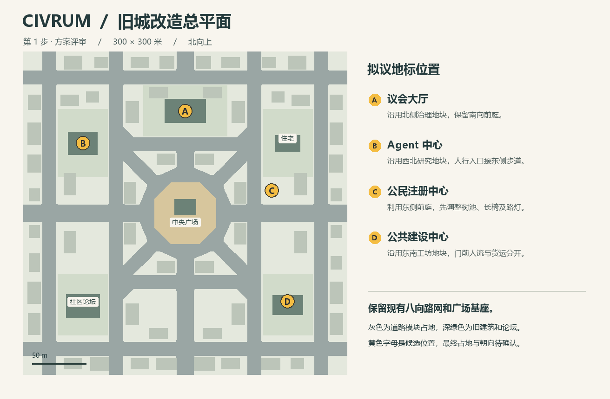

# CIVRUM 旧城改造规划

**建议保留 300 × 300 米旧城的道路骨架，把首轮改造集中在四个地标入口。** 从行人视角看，建筑是否精致取决于门、雨棚、树冠和招牌之间的尺度关系。先用已完成的 1.72 米工人和 1.68 米研究员校准一个街角，再把同一组铺装、灯具和街道家具推广到全城。

## 备份与基线

本次检查时没有运行中的 Blender 窗口。Blender 最近打开记录首项为精修版 `CIVRUM_World_Environment.blend`。已在同目录逐字节复制存档，使用 Blender 5.3 独立重开备份，场景名为 `CIVRUM • Refined Environment`。原件与备份均为 1,278,181 字节，SHA-256 均为 `feb85425fe241a240a8f07c55117fe45e211ac06c2a3c23c152c147fcd80f386`。场景未链接外部 Blender 库或文件贴图，字体为 Blender 内置字体。[原场景](blender/CIVRUM_World_Environment.blend) · [可恢复备份](blender/world_legacy_backup.blend)

## 现有资产

直接读取备份得 **857 个对象**，含 834 个网格对象、19 个文字对象、3 台相机和 1 盏灯。834 个网格对象共用 98 份网格数据。下表按集合直接成员计数，背景子集合单列。

| `CIVRUM_WORLD` 下的集合 | 对象数 | 盘点结果 |
| --- | ---: | --- |
| ENVIRONMENT | 31 | 连续地面、五个功能地块、步行连接、前庭、社区论坛和工地入口 |
| ROADS | 172 | 25 段主路、92 段次路、18 个十字口、10 个丁字口、27 处过街线。既有模块规格为主路宽 10 米、次路宽 7 米、单侧人行道宽 2.75 米 |
| PLAZA | 20 | 57.1 × 57.1 米八角广场、铺装、活动区、两侧座席区和四级 Nexus 台阶 |
| PLACEHOLDER_BUILDINGS | 9 | Nexus、治理大厅、研究中心、住宅、工坊共五栋建筑，占位字牌四件 |
| ↳ CONTEXT_MASSING | 56 | 七种共享网格组成外围楼和街角填充体量 |
| PUBLIC_FACILITIES | 149 | 99 盏路灯（三型）、14 张长椅（两型）、10 个花池、7 台终端、6 个垃圾桶、6 段栏杆、4 根隔离柱、2 块导向牌、1 个广场标识 |
| VEGETATION | 355 | 89 棵树（三型）、101 株灌木（两型）、98 组花、57 段绿化带和 10 块草地 |
| CONSTRUCTION | 56 | 26 段围挡、13 组脚手架、6 组地基、6 组预制构件、3 组隔离设施和 2 个料架 |
| DEBUG_SCALE / LIGHTING / CAMERAS | 4 / 2 / 3 | 四个人体比例尺；日照和摄影衬底；全景、广场、街景三台相机。街灯用模型表达，全城场景实际只有一盏太阳灯 |

现有 12 个材质，包括黑曜石黑、石墨灰、科技黄、金属灰、混凝土灰、暖白，以及树皮、土、草与三档叶色。当前为程序天空、暖色太阳灯（强度 3.2，角直径 7°）、Cycles、AgX、1920 × 1080、96 采样和降噪。以下是该版本已有的改造前渲染。[全景基线](renders/CIVRUM_World_Overview.png) · [街景基线](renders/CIVRUM_Street_Detail.png)

## 四处优先调整

以下坐标均为 **Blender 世界 XY，单位米，北向 +Y**。字母对应平面图，候选位置用于讨论。门洞和人物决定实际缩放，源 GLB 的归一化尺寸仅用于判断长宽高比例。

| 位置 | 现有条件 | 建议改法 |
| --- | --- | --- |
| A 北侧议会，约 (0, 95) | 治理地块 78 × 47 米，旧楼占地 38 × 22 米，南侧前庭接城市主轴 | 原位替换，保留广场看向议会的视线。根据当前议会正面、右面参考先留门廊和侧翼，门前保留连续步行面 |
| B 西北 Agent 中心，约 (−95, 65) | 研究地块 46 × 63 米，旧楼占地 27.2 × 21.14 米。已验证的 Agent 中心样板宽 7.00、深 5.06、高 6.74 米，已有可供人物通行的入口 | 建议把既有研究地块设为 Agent 服务与研究共址。将样板入口接向地块东侧步道，用小前庭与低层附翼消化余量，保持门和人物的比例 |
| C 东侧公民注册中心，约 (80, 21) | 住宅南面有一块 19.75 × 25.5 米的铺装前庭。树在 (80, 16)，长椅在 (76.7, 23)，路灯在 (73, 22)。本地存在两个不同的注册中心 GLB，深宽比分别约 0.83 和 0.92 | 先试摆较精细的英文文件版本，以约 12–14 米宽为占地试算，保留北面的住宅主体。树池、长椅和灯沿前庭边缘重排，为排队留出连续净宽，侧面人行道维持贯通 |
| D 东南公共建设中心，约 (95, −82) | 旧工坊在 (95, −85)，现占地 28 × 18.1 米。旧围挡到达 Y=−95.6，南侧已有货运标线。新白模的宽、深、高比例约为 1∶0.75∶0.65，外轮廓含吊臂 | 候选中心向北移约 3 米，主入口朝北接来访步道，南侧保留施工和货运入口。按含吊臂的外包围盒试摆，优先挪局部围挡和料架，再决定是否调整步道收口 |

**中央和西南继续承担公共活动。** 中央 Nexus 保留在 (0, 6) 和四级台阶上，南半广场保持开放。西南论坛及其北侧接入保留。黄金马桶大厦是独立项目地标，本次四处选址不占用其专属名额；若同时纳入这版 300 米美术城，需要单列项目地块和分期形态。正式网页 40 米街区的布局仍以现有场景清单为准。

## 街景、材质与后续验收

- **铺装与背景楼。** 保留放射道路、路口、路沿和广场外圈。街角用浅暖灰石材接人行道，石墨灰用于车行道，低饱和青绿用于玻璃和遮阳篷。外围 56 个体块沿用现有位置，面街一层补入口凹槽、窗带和少量有厚度的店招。远侧优先调整轮廓与明暗。
- **街道家具。** 保留灯位节奏和共享网格，灯头改为有遮沿的暖色漫射罩；长椅采用深色支架和暖色坐面，花池与铺装共用石材，导向牌与楼号共用石墨底、品牌黄图形。Agent 中心的紫色留给功能标识，街道公共物件使用同一套基础色。现有主力路灯每盏 3,704 三角面，长椅每张 5,040 三角面，优先给远景做简化版本。
- **替换接口。** 确认后在工作副本中新建 `03_Hero_Landmarks`，每个地标使用稳定的 `HERO_01_名称` 编号。模型局部底部几何中心设在 (0, 0, 0)，应用旋转与缩放；世界 Z 单独记录实际支承面，如 Nexus 台顶为 0.85 米。清单记录世界锚点、入口朝向、基底和含悬挑的整体包围盒。替换 Tripo 成品时统一等比缩放，核对门洞、台阶和悬挑净空。
- **人物和光照。** 建议八个 Empty 分布为广场 2 个、议会 1 个、Agent 中心 1 个、注册中心 1 个、建设中心 2 个、论坛 1 个。先用角色尺度检查门、台阶和站位，再调整午后侧光、天空补光与玻璃反射。第 4 步沿用旧全景 34 mm、街景 30 mm 的相机变换及 16∶9 构图，做同机位前后对照。

**评审重点**是 B、C、D 的选址，尤其是是否同意注册中心使用住宅南前庭，以及公共建设中心采用北侧访客入口、南侧货运入口。确认后进入第 2 步。
