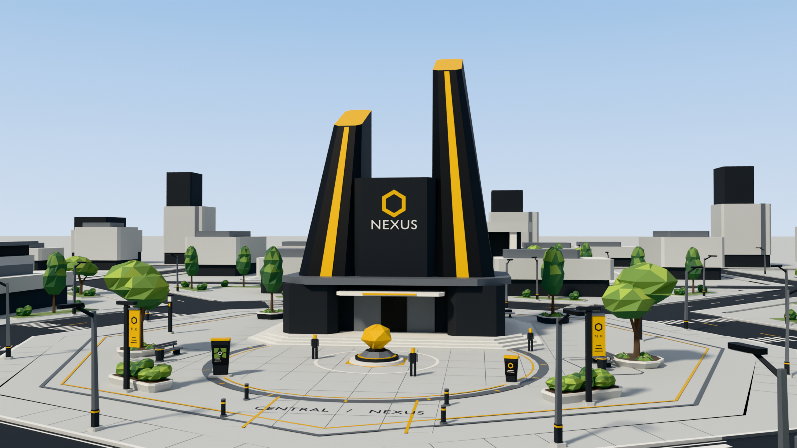
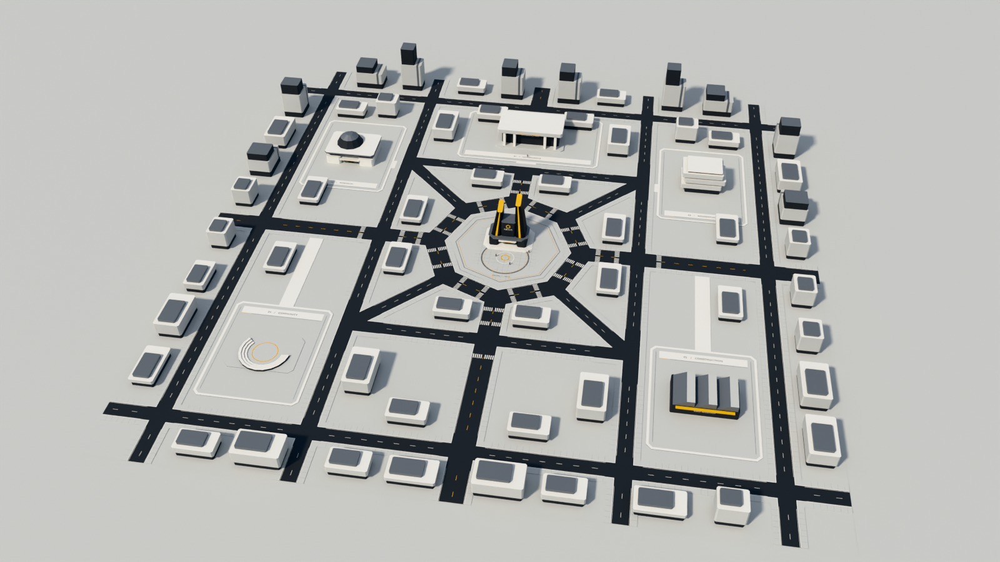

# CIVRUM 城市环境

[第二阶段城市工程](CIVRUM_World_Environment.blend) · [Blender 资产库](CIVRUM_Asset_Library.blend) · [总览](../renders/environment/CIVRUM_World_Overview.png) · [研究区街景](../renders/environment/CIVRUM_Street_Detail.png) · [施工区](../renders/environment/CIVRUM_Construction.png)



## 第二阶段 · 公共设施、绿化与施工

这一版从已验收的 300 × 300 米灰盒生成。中央活动圈放置一座金色多面体地标，周围可通行。导览终端、树池和带独立铺装的座椅沿两侧布置。研究区与住宅区的前庭采用错缝地砖、排水格栅和分区灯旗。工坊南侧留出八米出入口，地面箭头指向院内，地基、脚手架和材料架分区摆放。

资产库包含 **29 个原创网格模块**。每个模块都使用米制尺寸、地面原点和内嵌缩略图。将本目录添加到 Blender 的 **Preferences → File Paths → Asset Libraries**，即可从 Asset Browser 拖入模块，也可在 **File → Append → CIVRUM_Asset_Library.blend → Object** 中按名称取用。场景中的重复摆放共享网格。树木、花簇和灌木可随所属树池或绿化带一起移动。

| 集合 | 资产名称（均以 `CIVRUM_` 开头） | 尺寸或拼接约定 |
| --- | --- | --- |
| PUBLIC_FACILITIES | `PROP_PLAZA_BEACON_01` | 广场地标高 2.57 米、基座直径 3.94 米，多面体底部嵌入石墨色承座 |
| PUBLIC_FACILITIES | `PROP_STREETLIGHT_01…03` | 悬臂路灯高 5.89 米、挂旗灯高 5.14 米、步道灯高 3.47 米 |
| PUBLIC_FACILITIES | `PROP_BENCH_01…02`、`PROP_INFO_KIOSK_01…02` | 两款长椅长 2.45、3.12 米。全高及低位终端的面板朝局部 −Y |
| PUBLIC_FACILITIES | `PROP_PLANTER_01…03` | 3.50 米宽的多边形树池、4.60 × 1.65 米的长花槽、2.80 × 2.80 米的方形树池 |
| PUBLIC_FACILITIES | `PROP_BIN_01`、`PROP_WAYFINDER_01`、`PROP_BOLLARD_01`、`PROP_RAIL_01` | 垃圾桶高 0.98 米、指示牌高 2.89 米、隔离柱高 0.87 米。护栏沿局部 X 按 3 米节距排列 |
| VEGETATION | `TREE_01…03`、`SHRUB_01…02` | 阔叶树、柱形树、伞冠树分别高约 6.46、6.91、5.65 米。两款灌木高约 0.87、1.14 米 |
| VEGETATION | `GREEN_LAWN_01`、`GREEN_VERGE_01`、`GREEN_FLOWERS_01` | 草地 12 × 8 米，带缘石的绿化带 10 × 3.20 米，花簇宽约 1.32 米 |
| CONSTRUCTION | `CONSTRUCTION_FOUNDATION_01`、`CONSTRUCTION_FENCE_01`、`CONSTRUCTION_SCAFFOLD_01` | 地基按 6 × 4 米拼接，围挡节距 4 米。脚手架水平节距 3 米，垂直节距 2.40 米 |
| CONSTRUCTION | `CONSTRUCTION_RACK_01`、`CONSTRUCTION_PRECAST_01`、`CONSTRUCTION_BARRIER_01` | 管材架长 3.68 米，预制梁长 3.80 米、叠放节距 0.75 米，黑黄警示栏宽 2.60 米 |

构筑物沿用六种基础材质。植被额外共用六种哑光材质，分别表现两档叶面亮度、阴面叶片、草皮、土壤和树皮。每棵树为 212–278 个三角面，每簇花为 111 个三角面。

第二阶段场景包含 149 处公共设施、355 处植被和 56 处施工模块。连同第一阶段建筑、道路和地面，833 个网格对象共用 97 份网格数据，按场景中实际摆放累计 104,219 个三角面。统计排除了摄影衬底和字体对象。网页端帧率留待 GLB 导入后实测。

在仓库根目录运行以下命令，可以在一个新目录重新生成城市、资产库和四张 1600 × 900 预览。前三个机位对应第一阶段，第四张近景用于检查施工模块。

```powershell
& 'G:/blender/blender.exe' -b --factory-startup --python-exit-code 1 -P scripts/detail_civrum_world.py -- --output-root ../civrum-environment-review --render
```

运行以下命令可重新打开仓库里的两个第二阶段文件，检查道路接缝、模块放置、脚手架支撑、街具间距、建筑及车行道占用，以及资产库中的本地网格与缩略图。

```powershell
& 'G:/blender/blender.exe' -b --factory-startup --python-exit-code 1 -P scripts/detail_civrum_world.py -- --check
```

## 第一阶段 · 城市灰盒

[打开 Blender 场景](CIVRUM_World_Blockout.blend) · [城市总览](../renders/CIVRUM_World_Overview.png) · [中央广场](../renders/CIVRUM_Central_Plaza.png) · [研究区街景](../renders/CIVRUM_Street_Detail.png)

这是一张独立的 300 × 300 米城市美术地图，用于审阅街区布局、步行空间和建筑体量。坐标原点位于中央广场地面，向北为 +Y，向上为 +Z，1 Blender Unit 等于 1 米。中心 160 × 160 米内设置八向放射路网，外围用次级道路和共享灰盒体量标出扩建用地。当前网页继续使用自己的 40 × 40 米 `district-01@1` 场景清单。



## 地块和建筑位置

| 区域 | 地块中心 X, Y（米） | 地块或广场尺寸 | 本阶段内容 |
| --- | --- | --- | --- |
| Central Nexus | 0, 0 | 八边形，对角约 57.1 米 | Nexus 基座向北退 6 米，南侧留出活动空间 |
| Governance | 0, 95 | 78 × 47 米 | 治理大厅、南向前庭和步行入口 |
| Research | −95, 65 | 46 × 63 米 | 带低矮穹顶的研究中心占位 |
| Residential | 95, 65 | 46 × 63 米 | 错层住宅占位 |
| Community | −95, −85 | 46 × 57 米 | 开放式阶梯活动场，朝北连接步道 |
| Construction | 95, −85 | 46 × 57 米 | 工坊占位及预留施工面 |

## 集合和模块

在 Outliner 中展开 `CIVRUM_WORLD`。在集合内选中对象，可查看其名称、坐标、材质和局部网格。

| 集合 | 资产名称或前缀 | 尺寸与编辑约定 |
| --- | --- | --- |
| ENVIRONMENT | `CIVRUM_ENV_GROUND_MAIN`、`CIVRUM_LOT_*`、`CIVRUM_WALK_*` | 地面连续覆盖 X/Y −150 至 150 米，五块功能用地可单独编辑 |
| ROADS | `CIVRUM_ROAD_STRAIGHT_MAIN`、`…_LOCAL`、`…_TEE`、`…_CROSS`、`…_CROSSWALK` | 主干车行道宽 10 米，次干道宽 7 米，每侧人行道宽 2.75 米。标准直段长 20 米，短段收口。局部 +X 从起点指向终点，原点在起点中心的地面标高 |
| PLAZA | `CIVRUM_PLAZA_OCTAGON`、`…_TILE_01`、`…_NEXUS_STEP`、`…_FORUM_INLAY` | 铺装模块按 10 × 10 米节距排列，板间留 4 厘米缝。Nexus 四级台阶每级高 16 厘米 |
| PLACEHOLDER_BUILDINGS | `CIVRUM_PH_CENTRAL_NEXUS`、`…_GOVERNANCE_HALL`、`…_RESEARCH_CENTER`、`…_RESIDENTIAL_HOUSE`、`…_BUILD_WORKSHOP` | 五栋主占位各有一个网格对象。原点在基底中心，主入口朝局部 −Y。立面字样随父对象移动 |
| PLACEHOLDER_BUILDINGS / CONTEXT_MASSING | `CIVRUM_PH_INFILL` | 外围和街角的体量参考，多处共用同一网格 |
| DEBUG_SCALE | `CIVRUM_DEBUG_HUMAN_175` | 1.75 米人体比例尺，四处放置 |
| LIGHTING | `CIVRUM_SUN`、`CIVRUM_STUDIO_GROUND_SWEEP` | 日照与远景地面衬底。衬底只服务预览，游戏地图尺寸以 ENVIRONMENT 为准 |
| CAMERAS | `CIVRUM_CAM_WORLD_OVERVIEW`、`…_CENTRAL_PLAZA`、`…_STREET_DETAIL` | 三个透视机位分别检查完整路网、广场入口和行人视角，渲染规格为 1600 × 900 |
| VEGETATION、PUBLIC_FACILITIES、CONSTRUCTION | 第二阶段工作集合 | 已预留给绿化、公共设施和施工模块 |

材质共用六个 Principled BSDF。可在材质面板按 `MAT_` 搜索。黑色 `#141619` 与石墨灰 `#292D32` 用于主体与道路，科技黄 `#F0B90B` 用于导向和入口识别，金属灰 `#747A80`、混凝土灰 `#C5C6C3`、暖白 `#E7E5DF` 用于铺地和体块分层。

链接网格的编辑会反映在同一模块的其他实例上。单独改造一个实例前，可在 Object Data Properties 中点击网格名称旁的用户数，使其成为单用户网格。替换建筑时，保留地块和台阶，将新模型对齐到对应主占位的原点与朝向，再隐藏占位及其字样。

## 重建和检查

在仓库根目录执行以下命令。已用 Blender 5.3.0 验证。生成器会检查目标文件名，已存在时会停止，手工修改过的场景可以保留。示例将重建结果放到新目录。

```powershell
& 'G:/blender/blender.exe' -b --factory-startup --python-exit-code 1 -P scripts/build_civrum_world.py -- --output-root ../civrum-layout-review --render
```

检查仓库里已经保存的场景，运行以下命令。

```powershell
& 'G:/blender/blender.exe' -b --factory-startup --python-exit-code 1 -P scripts/build_civrum_world.py -- --check
```

重开核验结果为 59 段连通路网、28 个路口、117 个直线模块，实测车行道接缝最大偏差约 0.0043 毫米。场景内的游戏环境与比例尺共有 266 个网格对象，使用 63 份网格数据，按摆放实例累计 17,544 个三角面。统计排除了摄影衬底和字体对象。

## 后续 GLB 导出

正式模块 GLB 交付和回导验证安排在第三阶段。届时可在 Blender 选中一个道路或广场模块，将副本的位置和旋转归零，保留它的局部原点。通过 **File → Export → glTF 2.0** 选择 **glTF Binary (.glb)**，启用 **Selected Objects** 和 **+Y Up**，保存到仓库的 `exports/`。字体如需随模块交付，先把选中的字体副本转换为网格。对独立模块回导时，核对尺寸、朝向、材质和与相邻模块的接缝。
