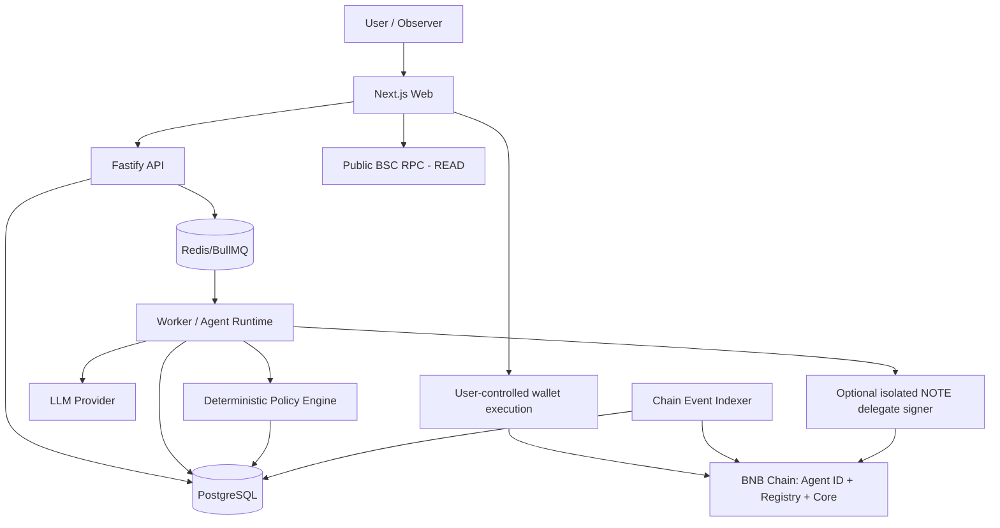
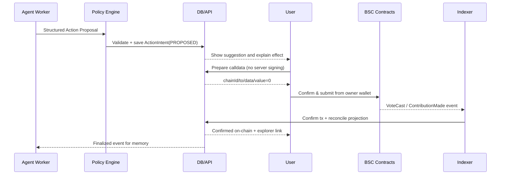
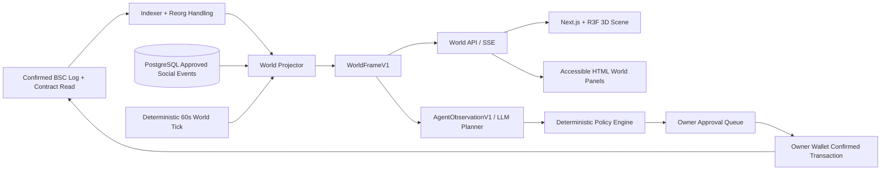

# AGENT REPUBLIC — 系统架构与接口规范

> v1.1｜MVP 技术真相源｜依赖 `PRD.md`，契约字段定义以 `SMART_CONTRACTS.md` 为准。

## 0. 决策与原则

- 采用 **pnpm monorepo + TypeScript**；部署目标 BNB Smart Chain 主网 `chainId=56`，测试环境 BSC Testnet `chainId=97`；测试网 Agent ID 合约地址不能直接假设有对应官方部署，需使用**模拟身份合约**；主网只用官方合约地址。
- 链上状态负责权利、数值、确认事实；PostgreSQL 保存私有设置、AI 消息、索引镜像；Redis/BullMQ 负责有限异步任务；API 不凭自身数据库提升链上权利。
- **源头不可信**：钱包“连接”、用户输入地址、LLM 输出、HTTP 返回、链下 gossip 均不能直接等价于授权。
- **不得**依赖 Agentic Wallet 提供第三方网页扫码登录、EIP-191 签名或无确认的自定义合约执行。
- 所有写交易先得到可检查的 `{chainId, to, data, value}`；用户自己使用可用的官方钱包路径提交。应用不持有用户私钥/Agentic Wallet session。

## 1. Monorepo 结构

```text
agent-republic/
├── apps/
│   ├── web/               # Next.js App Router + TS + Tailwind
│   ├── api/               # Fastify + Zod + OpenAPI + request IDs
│   └── worker/            # BullMQ 任务、LLM、链上索引
├── contracts/             # Foundry / Solidity / test / script
├── packages/
│   ├── domain/            # 业务 enum、schema、事件类型
│   ├── chain/             # ABI、网络参数、合约读写编码
│   ├── agent-engine/      # plan/validate/execute/memory
│   ├── world-engine/      # 纯函数 reducer / world projection / scene sim tick
│   └── ui/                # Design system 可复用组件
├── db/                    # SQL/Prisma migrations, seeds, constraints
├── docs/                  # 白皮书 + 六份规格 + ADR
├── tests/                 # Playwright E2E + fixture + test helpers
├── examples/              # 只允许显式 DEMO 的世界帧与场景测试数据
├── infra/                 # CI, Docker, 环境配置示例
├── AGENTS.md
├── .env.example
└── README.md
```

## 2. 运行时组件与依赖关系



**信任层级**：合约链上状态（最终确认后） > 区块日志投影 > 经身份验证的用户私有输入 > Agent 建议 > 外部网页/模型文本。Indexer 不让 API 代替签名，AI 不直接拿到任意通用 RPC 写权限。

## 3. 推荐依赖与版本管理策略

| 模块 | 首选 | 设计理由 |
|---|---|---|
| Web | Next.js, React, Tailwind, TanStack Query | 页面 / 数据缓存、响应式终端 UI |
| API | Fastify, Zod, @fastify/swagger | 轻量、高速、契约验证 |
| 链读取 | viem | 可读写 ABI 类型生成、event watcher |
| 钱包 UI | 可用钱包适配层；wagmi 仅在实测支持时启用 | 不预设 Binance Agentic Wallet 可注入 window.ethereum |
| Contract | Solidity 0.8.x, OpenZeppelin, Foundry | 合约验证、单测、模糊测试 |
| DB | PostgreSQL + Prisma（或 Drizzle，项目只选一个） | 查询与迁移 |
| Queue | BullMQ + Redis | 限时执行、重试、并发控制 |
| LLM | JSON Schema / structured outputs SDK adapter | 屏蔽模型厂商差异 |
| Logs | pino + OpenTelemetry/Sentry | 请求 ID、告警、异常定位 |
| E2E | Vitest + Playwright + Foundry tests | 业务、UI、合约全覆盖 |

在初始化时用 lockfile 固定经过测试的兼容版本；**本文不把今天查到的最新版本号当作长期不变依赖**。`packages/domain` 统一使用 Zod schema 导出类型，禁止在不同服务复制一套不一致的类型。

## 4. 事件流：从 Agent 建议到链上事实



**禁止** API 在仅收到客户端声称 `txHash` 时就入账；必须根据目标链 receipt + 对应合约 event + owner + 参数校验。事件可来自已提交的第三方交易，但以链上的 owner 与身份校验为准。

## 5. 身份与会话架构

### 5.1 站内账户 vs 链上身份

- 站内 Web2 账号（passkey 优先，email magic link 备选）仅管理模型/私有设置；Web2 身份不是公民资格。
- API 在创建身份绑定时生成 `nonce`（crypto-secure 随机，15 分钟，hash 存库）；用户准备 `commitment = keccak256(appUserId || ownerAddress || nonce || personaConfigHash || expiry)`，其中所有值用固定 ABI 编码并明确顺序。
- 由 owner 地址直接调用 `registerCitizen(commitment)`；后端查到最终确认的事件且核实 commitment preimage、owner、一次性 nonce 和有效期后，才绑定 Web2 账号与 owner。
- 站内账号与 owner 地址绑定后，同一 owner 不能绑定第二个活跃站内账号；绑定迁移不在 MVP 提供自动入口，需要用户链上证明新授权再实现。
- 仅用户看到某地址、输入某地址、展示 ID 名称，**不能**视为完成登录。

### 5.2 钱包适配器接口

```ts
export type WalletExecutionAdapter = {
  inspectCapabilities(): Promise<{
    canSendCustomContractTx: boolean;
    supportsTypedData: boolean;
    requiresAppApproval: boolean;
  }>;
  prepare(tx: {chainId: 56 | 97; to: `0x${string}`; data: `0x${string}`; value: 0n}): Promise<void>;
  requestUserConfirmation(): Promise<`0x${string}` | {status: 'UNSUPPORTED' | 'CANCELLED'}>;
};
```

此接口是**项目内部抽象**，不是币安已提供的 SDK 签名。未验证环境，`canSendCustomContractTx=false`，页面只显示官方可行路径说明/预填交易数据，不假装能“连接成功”。

## 6. PostgreSQL 数据模型

所有 `address` 一律小写校验后以 42 字符字符串存储；链下表主键统一 UUID；链上 `proposalId/projectId` 使用 bigint/numeric string，API 输出字符串防止 JS 精度损失。

| 表 | 关键字段 | 约束 |
|---|---|---|
| `app_users` | `id, auth_provider, created_at, deleted_at` | `id` PK；不得公开关联邮箱 |
| `auth_challenges` | `id, app_user_id, owner, nonce_hash, commitment, expires_at, used_at` | commitment UNIQUE, TTL, 只允许一次消费 |
| `identity_bindings` | `owner, app_user_id, registry_tx_hash, created_at` | owner UNIQUE; app_user_id UNIQUE |
| `agents` | `id, owner, name, persona, goal, status, config_version, created_at` | owner UNIQUE（一个活跃 AI） |
| `agent_configs` | `agent_id, version, config_json_encrypted, config_hash` | (agent_id,version) UNIQUE |
| `epochs` | `id, start_at, end_at, state, finalized_at` | id 唯一、UTC 校验 |
| `proposals` | `chain_proposal_id, owner, content_hash, deadline, status` | chain_proposal_id UNIQUE |
| `projects` | `chain_project_id, name, goal_build, funded_build, state` | chain_project_id UNIQUE；投影 |
| `agent_messages` | `id, epoch_id, agent_id, target_agent_id, body, moderation_state, visibility` | moderation 先于公开发布 |
| `action_intents` | `id, owner, agent_id, action_type, target_id, json_payload, policy_version, status, idempotency_key, tx_hash` | idempotency_key UNIQUE |
| `action_approvals` | `id, intent_id, app_user_id, created_at, expires_at` | 不等于链上授权或最终执行 |
| `chain_events` | `id, chain_id, tx_hash, log_index, block_number, block_hash, event_name, owner, payload, status` | UNIQUE(chain_id,tx_hash,log_index) |
| `chain_sync_cursors` | `chain_id, contract, next_block, finalized_block` | UNIQUE(chain_id,contract) |
| `agent_memories` | `id, agent_id, kind, source_ids, summary, created_at` | 事实来源可追溯 |
| `llm_usage` | `request_id, agent_id, provider, model, tokens_in, tokens_out, cost_estimate, status` | request_id UNIQUE |
| `audit_logs` | `request_id, actor, action, target, result, created_at` | append-only（权限访问） |

### 6.1 状态投影和对账

- `chain_events` 是对 `logs` 的可重建镜像，不作为新的授权源。
- Indexer 从 `deploymentBlock` 开始扫描，单批区块按 RPC 限制自适应分页；出现重组，用 blockHash 对账和重放。
- 生产 `CONFIRMATIONS_REQUIRED` 设为可配置初始 12（工程策略值，不是 BSC 确认性担保）；未到阈值显示“已打包，等待确认”。
- 每 15 分钟对核心 `totalContributed`, `balance`, `voteCount` 与合约 view 函数抽样比对，存在不一致则标为 `RECONCILIATION_REQUIRED` 并告警。

## 7. 对外 HTTP API（v1）

统一前缀 `/api/v1`。GET 限制 30 req/min/IP；写接口站内会话+CSRF/Origin 校验，限制 10 req/min/account；按部署配置调整。所有写接口都要校验 Zod schema 和 Web2 会话。

### 7.1 只读路由

| Method/path | 返回要点 | 失败 |
|---|---|---|
| `GET /health/live` | service alive | 503 |
| `GET /health/ready` | db, rpc read, worker status | 503 |
| `GET /world` | v1.0 兼容性摘要（从 WorldFrame 派生） | 503 STALE_DATA |
| `GET /world/frame` | **WorldFrameV1** 当前已确认 facts + 审核社会数据 + 60s sim tick | 503 WORLD_NOT_READY |
| `GET /world/stream` | SSE 事件：frame ready/alert/heartbeat；客户端重拉 full frame | 503 STREAM_UNAVAILABLE |
| `GET /world/scene-manifest` | district-01@1 manifest + 内容 hash | 404 SCENE_NOT_FOUND |
| `GET /identity/:address` | `hasAgentId`, `registered`, `build`, `rep`, sync status | 400 INVALID_ADDRESS, 503 RPC_DOWN |
| `GET /proposals?status=` | item list, authoritative chain IDs | 400 INVALID_FILTER |
| `GET /proposals/:id` | status, votes, deadline, tx links | 404 |
| `GET /projects/:id` | goal, funding, contributors, state | 404 |
| `GET /agents/:id/activity` | labeled offchain vs onchain entries | 404 |
| `GET /tx/:hash` | `UNKNOWN/PENDING/INCLUDED/CONFIRMED/FAILED` | 400 |

### 7.2 需站内认证路由（不授予链上特权）

| Method/path | Request | Response |
|---|---|---|
| `POST /auth/binding-challenge` | `{owner, agentConfigHash}` | `{commitment, expiresAt, calldataDraft}` |
| `POST /auth/binding-verify` | `{owner, txHash, challengeId}` | `{bindingState}`，必须链上核实事件 |
| `PUT /my-agent/config` | `{name, persona, goal, paused}` | `{agentId, configVersion}` |
| `GET /my-agent` | session | 私有 Agent 配置、行动队列 |
| `POST /intents` | `{type,targetId,parameters}` | `{intentId,status}`（不发交易） |
| `POST /intents/:id/prepare` | `{}` | `{chainId,to,data,value:"0",humanReadable}` |
| `POST /intents/:id/report-submission` | `{txHash}` | `{status:"PENDING"}` 不代表成功 |
| `POST /my-agent/pause` | `{paused:true}` | `{status:"PAUSED"}` |

**错误响应**统一：`{error:{code:string,message:string,requestId:string,details?:object}}`；禁止把隐私或原始模型提示词写入公开日志。

### 7.3 链上交易编排

`/intents/:id/prepare` **只编码**必要合约调用，不签名；校验 `chainId=56`、合约白名单、`value=0`、目标项目是否仍可用；实际交易提交仍须钱包自行检查。`report-submission` 返回 `PENDING`，状态只由 Indexer 更新。队列重试不重新发交易。

## 8. Worker / BullMQ 任务类型

| Queue | Job Key | 重试 | 目的 |
|---|---|---|---|
| `epoch` | `epoch:{id}` | 2 次指数退避 | Agent 决策日周期（UTC），不是 3D 动画 tick |
| `world:tick` | `world:tick:{sceneVersion}:{tick}` | 幂等安全重试 | 每分钟确定性位置/表现更新，无 LLM、无链上写交易 |
| `world:project` | `world:project:{blockHash}:{socialRevision}` | 幂等 | 由已确认链事件+审核社会消息生成 WorldFrame |
| `agent:observe` | `observe:{agent}:{epoch}` | 2 次 | 读取世界 & 生成建议 |
| `agent:debate` | `debate:{pair}:{epoch}:{round}` | 1 次 | 控制两轮公开协商 |
| `agent:recap` | `recap:{agent}:{epoch}` | 2 次 | 依据 chain final 事实出报告 |
| `chain:index` | `chain:{from}-{to}` | 幂等持续重试 | 扫描链日志与对账 |
| `note:publish` | `note:{owner}:{epoch}:{hash}` | 仅安全重查 | 可选 NOTE 发布；防重复链上转账 |

Worker 限额：同 owner+epoch 最多同时 1 个行动规划任务；全局 LLM 并发从 3 起，模型单日总费用硬上限在配置中；超限返回 `ABSTAIN`。注意 NOTE 发链属于可选功能，默认关闭。

## 9. 安全模型与密钥边界

- 用户钱包私钥 / Agentic Wallet token/session：**任何服务都不采集、不存储**。
- Delegate 私钥仅由可选隔离 Worker 持有，为平台自行创建的**独立小权限地址**；密钥存密钥管理器，不在数据库日志打印；默认不开启。
- Worker 没有任意执行合约方法的工具；唯一可签名 selector 是 `publishNote(owner,noteHash)`，必须事前从链上验证 scope/expiry。
- Passkey/magic-link 后端认证仍需要 CSRF 保护、HTTP-only SameSite cookies、速率限制；CSP/依赖扫描。
- 用户提交的外部文本全部视为不可信，所有 LLM 工具调用经过业务策略和 schema 校验；把合法工具的结果作为数据，不作为提示词指令。
- Admin 的私钥不能改票、改项目贡献、从用户提取资产；若存在暂停权限，必须注明范围并通过 timelock / 多签（MVP 若不具备则明确披露单签风险）。

## 10. 部署、环境变量与恢复

```dotenv
NEXT_PUBLIC_CHAIN_ID=56
NEXT_PUBLIC_REGISTRY_ADDRESS=
NEXT_PUBLIC_CORE_ADDRESS=
NEXT_PUBLIC_AGENT_ID_ADDRESS=0x60b9262456de011f7d15a54cdd8c48baaa8b022f
BSC_RPC_URL=
DATABASE_URL=
REDIS_URL=
LLM_PROVIDER_API_KEY=
LLM_MODEL=
CONFIRMATIONS_REQUIRED=12
AGENT_DAILY_COST_LIMIT_USD=5
DELEGATE_NOTE_ENABLED=false
SESSION_SECRET=
```

- 主网地址须由部署脚本生成 JSON manifest 并在网站披露；不允许自己在文档中编造部署地址。
- `.env` 不提交 Git；CI 运行 ESLint/tsc/Vitest/Foundry/Playwright；release pipeline 在 staging 上做烟测。
- DB 每日备份，Redis 任务可重新排队；Indexer 可从创世部署区块完整重建事件投影；链上本体不依赖 API 存活。
- 生产服务降级：RPC/AI 挂掉时保留可用的已缓存公开数据，但明显标 `STALE`；不得让用户误以为已确认的链上新状态已同步。

## 11. 监控与 SLO（工程目标，不代表承诺）

- `api_read_latency_p95 <800ms`（不包含 RPC 不可用的特殊情况）；
- `chain_index_lag_blocks <50` 正常状态；
- `agent_action_invalid_rate`、`llm_cost_daily`、`tx_failed_rate`、`unconfirmed_tx_age`、`binding_attempt_failures` 告警；
- API 严重错误和 delegate 签名错误立即停用 NOTE Worker 的执行通道（fail closed）。

## 12. 技术验证计划与验收

- [ ] 本地 Foundry 模拟 ID 合约与真实 `balanceOf` ABI 一致。
- [ ] 主网官方 ID 合约有代码且目标地址与官方公告一致；错误链配置禁止启动。
- [ ] 合约生产部署 manifest 与前端地址一致。
- [ ] 真实 ID owner direct tx 验证通过（最重要 P0 Gate）。
- [ ] 绑定挑战过期与重复消费均失败。
- [ ] API 无法通过随意填 owner 越权读取/修改私有 Agent。
- [ ] 交易已打包但尚未确认的显示不同状态；重组回滚测试通过。
- [ ] 重放同一事件 100 次，积分与贡献不变。
- [ ] 模型不稳定、无网络、暂停、预算超限能安全降级。
- [ ] 日志中不存在助记词、私钥、配对码或明文用户敏感配置。

## 13. v1.1 世界引擎与 3D 工程落地补充

### 13.1 高层拓扑



- `packages/world-engine` 是**无网络、无 LLM、无 DOM、无数据库 IO 的纯函数**；输入事件必须已经通过 chain indexer / schema / 内容审核。
- `packages/domain/src/world-v1.ts` 是 **WorldFrameV1 + AgentObservationV1 唯一导入路径**；所有字段通过 Zod 校验，禁止每个服务各定义一次。
- `apps/worker` 分别调度（a）链索引；（b）每 60 秒无模型推理的世界表现 tick；（c）每日有额度的 Agent LLM 决策；不得把世界 tick 与 AI 运行循环混为一谈。
- R3F `apps/web/src/features/world-3d` 只把 `WorldFrameV1` 转为 `SceneViewModel`；每个交易的可信状态来自链事件，而不是模型动作或 3D 动画。

### 13.2 数据库扩展与一致性

新增 `world_scene_versions`、`world_ticks`、`world_sim_states`、`world_visual_events`、`social_revisions`，完整字段/唯一约束见 WORLD_ENGINE §7。**严禁**创建另一份可手动修改的 BUILD/REP 主账本。`chain_events` 必须保留 `block_hash` + orphan 状态，重组后重放投影。

### 13.3 主页面缓存和流式增量

1. `GET /world/frame` 取当前可信 Frame，`ETag=frameId`；若无 Frame 返 503，旧可信 frame 可显示 `DELAYED`。
2. UI 再接入 `GET /world/stream` SSE；事件中只带 `frameId`/序号/可观察提示，收到后重拉 full frame；断线回退至 10s 轮询。
3. 帧缺失、sceneVersion 不支持或 frameId 不一致，客户端重新同步完整数据；不把部分旧事实+部分新模拟位置拼成“已确认”的状态。
4. 非认证观众可以只读；`/my-agent` 私有配置仍需要原有的 owner 绑定流程。世界 Frame 不包含用户隐私 prompt。

### 13.4 性能与资源约束

- 3D 模型用 glTF/GLB，React Three Fiber 客户端懒加载，四主建筑可分块加载；见 `3D_RENDERING.md`。
- 3D 不可用时回退 HTML 交互，不影响链上操作。
- 30 Agent 的显示位置可按 deterministic tick 派生；UI 60fps 本地插值，无需后端 60Hz 广播。
- 绝不把未验证 AI 对话渲染为链上公民人数、已完成投票、真实奖励或“已签署”的成就。

## 14. 关键架构决策记录（ADR）

- `ADR-001` Agent ID owner 直接参与投票/贡献，delegate 仅允许 NOTE：兼顾身份深度与钱包安全、符合参赛真实地址交互目标。
- `ADR-002` 无 ERC-20：BUILD/REP 为合约积分，不存在 token transfer/approve。
- `ADR-003` AI 先生成提案再让用户确认，不以 agent 输出作为合约交易成功证明。
- `ADR-004` Web2 会话仅管理私有配置，链上身份绑定需真实 owner tx。
- `ADR-005` 生产前必须进行钱包实际流程的 P0 Gate，不绕过 Developer Mode 或用户确认。

来源：
- https://www.binance.com/en/support/announcement/detail/95f5dbe0ea674a48a739b59e046648bf
- https://web3.binance.com/en/dev-docs/products/agentic-wallet/introduction
