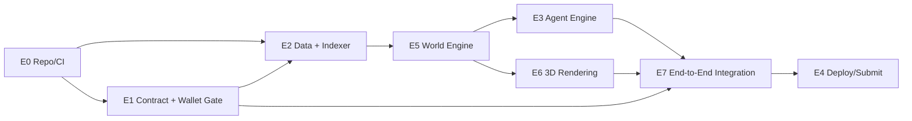

# AGENT REPUBLIC — IMPLEMENTATION_PLAN.md

> **v1.1 自研版**｜起点 2026-11-18（UTC+8）｜黑客松提交截止 2026-12-09 16:00（UTC+8）。本计划是高风险压缩型工程路线，**不是承诺 21 天内一定全部实现**。始终优先核心身份安全和真实交易，其次可运行世界，最后才是渲染修饰。

## 0. v1.1 决策与核心变化

1. 不 Fork Pixel AI Town / AI Town / IsoCity 作为主代码库，所有核心行为规则自研。
2. 新增 `WORLD_ENGINE.md`：唯一 `WorldFrameV1`、事件归约、链上事实/链下社会分离、60 秒确定性模拟 tick、建筑状态派生。
3. 新增 `3D_RENDERING.md`：原生 React Three Fiber 正交城市、四建筑、30 个可见 Agent、真实建设阶段、交互/降级/性能。
4. `AGENT_ENGINE.md` 改成消费 `AgentObservationV1`（从 WorldFrame 裁剪），避免独立世界状态副本。
5. 合约 BUILD/REP/权限 **不修改**，避免重做已经定义的经济和安全规则。
6. 任何生产界面不得以 mock 数据冒充真实链上项目；自研世界的**动画并非链上事件**。

## 1. 最终 Definition of Done

**必须交付（P0）**

- [ ] BSC 主网 Agent ID `balanceOf` 校验实际有效（主网合约地址在配置 guard 中锁定）。
- [ ] 至少 1 个真实 Agent ID 持有者经官方允许的钱包路径发起、确认项目合约写交易，并留存 txHash / 发起地址 / 日志证据；不收集 Agentic Wallet 会话。
- [ ] Registry/Core 通过单测、关键 invariant，主网部署与 BscScan 源码验证并公开 GitHub 代码。
- [ ] 账户身份绑定不能只靠输入地址；正式注册/投票/贡献必须由持有者钱包直接发起。
- [ ] `WorldFrameV1` 可基于已确认事件重复生成，能处理 pending/confirmed/reorg；BUILD/REP 无双账本。
- [ ] 城市有四个可点击原生 3D 建筑和低多边形 Agent 标记；项目 #1 按链上进度四阶段变化；无 WebGL 能用 HTML 列表。
- [ ] 至少两个不同人格的 Agent 消费 `AgentObservationV1` 产生有证据来源且受权限限制的建议/协商；链上操作只进待确认队列。
- [ ] README 解释合约/技术边界、真实 vs 模拟、钱包交互路径；现场可演示闭环。
- [ ] 若有参赛 30 地址目标，必须在活动期真实链上逐个验证，不保证主办方统计一定一致；不足据实说明。

**非目标**：大规模人口城市、3D 房地产、可交易代币、代理自动支付、复杂 A* 导航、模拟经济伪资金、跨链完整治理、高保真 30 个独立人物模型。

## 2. 四道不可跳过的质量门

| Gate | 必须验证 | 不通过时怎么办 |
|---|---|---|
| A 钱包可行性 | 真实官方 Agent ID owner 通过允许路径发写交易并核对 tx | 主线转只读展示+本地模拟，暂停宣称“可参赛链上闭环” |
| B 合约规则 | Foundry Unit/Fuzz/权限/经济不变量，源码可验证部署 | 不主网部署，不用 UI 模拟修复合约错误 |
| C 世界状态与 AI | 同输入同帧、reorg 回放，Agent 不能改 BUILD，真实 tx→UI→AI recap | 删复杂 Agent 行为和动画，保留可信世界 |
| D 上线与提交 | 主网合约验证、公开网站、开源、真实交互及官方提交材料 | 如实披露功能未达成，绝不虚报互动数量 |

## 3. 21 天建议日历（北京时间/新加坡时间）

| 日期 | 重点 | 最低交付 | 风险应对 |
|---|---|---|---|
| 11/18 D0 | v1.1 文档/仓库初始化 | docs、pnpm monorepo、CI 基础 | 不先做视觉大场景 |
| 11/19 D1 | Agent ID 与 Wallet Spike | 主网只读验证 + 自定义合约验证方案 | 必须真人执行和记录 |
| 11/20 D2 | 真实交易 P0 Gate | owner 直接交易、receipt、event 证据 | Gate A 决策 |
| 11/21 D3 | Registry | 身份合约、单测 | 保持接口最小 |
| 11/22 D4 | Core 基础 | 注册/议题/BUILD 存储 | 不引入代币 |
| 11/23 D5 | 治理与贡献 | 投票/贡献/REP 数学单测 | 不超过一套账本 |
| 11/24 D6 | 合约安全收敛 | fuzz/permissions/部署脚本 | Gate B 预检 |
| 11/25 D7 | 链上与数据库 | migration、indexer/reorg | 错误先修而非美化 UI |
| 11/26 D8 | WORLD_SCHEMA | domain schema、世界投影、初始 frame | 不连接 LLM |
| 11/27 D9 | WORLD_REDUCER | 60s tick、建筑阶段、稳定 seed/回放 | Gate C 世界侧预检 |
| 11/28 D10 | 可读世界 API | frame/SSE/fallback、指标面板 | 无 WebGL 仍能用 |
| 11/29 D11 | 3D 基础城市 | R3F 场景、相机、四栋几何建筑 | 用程序化原创几何启动 |
| 11/30 D12 | 3D 交互 + BUILD 阶段 | picking、施工阶段、事件动效 | 只接受 confirmed 数据 |
| 12/01 D13 | Agent Runtime | observation/planner/policy | 严格模型预算 |
| 12/02 D14 | 两 Agent 协商 | 记忆/审核/来源标签 + Agent 显示 | 不做无限自主循环 |
| 12/03 D15 | 完整链路演练 | 真 tx → indexer → frame → 3D → AI recap | Gate C |
| 12/04 D16 | 主网部署+验证 | 合约地址/BscScan/公开站点 | Gate B+D 部分条件 |
| 12/05 D17 | 真实用户试用 | 修复钱包流程、上线使用引导 | 争取真实用户 |
| 12/06 D18 | 性能与安全 | 3D FPS、WebGL fallback、权限/索引复测 | 砍额外资产 |
| 12/07 D19 | 录屏、提交材料 | 真实演示视频、说明、截图 | 无 mock 伪装主网 |
| 12/08 D20 | 冻结并提前提交 | 最终测试+资料+确认提交 | 留时间容错 |
| 12/09 16:00 前 | 官方截止 | 复核官方要求与交易 | 截止以官方活动规则为准 |

**如进度滞后**：优先削减动态角色数量、模型细节、NOTE 代理、额外议题、历史回放 UI，**不可删除**身份验证、真实合约经济、用户确认和事实来源区分。

## 4. Codex 任务 ID 和依赖 DAG



### E0 — 基础工程（先执行）

| ID | 任务 | DoD |
|---|---|---|
| E0-01 | pnpm TS strict monorepo `apps/{web,api,worker}`, `packages/{domain,chain,world-engine,agent-engine,ui}`, `contracts` | install/build/typecheck 运行成功 |
| E0-02 | chainId、官方 Agent ID 地址 guard；环境变量类型化 | 主网地址缺失/不匹配直接拒绝启动 |
| E0-03 | lint、unit test、Foundry、CI、secret scan | PR 检查可重复，失败有日志 |
| E0-04 | README、ADR、安全威胁边界、DEMO fixture 警示 | 新人能区分已实现和计划中的功能 |

### E1 — Agent ID 合约与钱包先行

| ID | 任务 | DoD |
|---|---|---|
| E1-00 | **真实 Wallet Spike (Gate A)** | `txHash`、owner、Agent ID balanceOf、receipt + event，可复验 |
| E1-01 | MockAgentID、Registry 注册 | 重复注册和无身份交易 revert |
| E1-02 | NOTE-only Delegate/撤销/锁定 | delegate 不能投票/贡献 |
| E1-03 | 创世项目/BUILD 初始余额 | goal 2000、funded 0、注册后 +100 BUILD |
| E1-04 | 正式提案/投票/结算 | 48h、quorum、one-owner-one-vote、每日奖励上限 |
| E1-05 | contribute/REP | 拆单、上限、剩余量、结束边界单测 |
| E1-06 | NOTE/审计事件（时间不足可延期） | 日配额、只写 hash、不可冒充 owner |
| E1-07 | Foundry fuzz / invariant / 安全 | 全部 P0 不变量通过（Gate B） |
| E1-08 | 部署脚本、ABI、BscScan verif | 部署可复现，合约与 env manifest 一致 |

### E2 — 数据/链索引/基础 API

| ID | 任务 | DoD |
|---|---|---|
| E2-01 | Postgres schema + migrations | DB 清库可完整重建，包含 world 扩展表 |
| E2-02 | chain event indexer，重组回退 | 重放一致，避免 pending 计账 |
| E2-03 | `GET /identity/:address`, `/proposals`, `/projects` | 读链显示来源和时间/错误 |
| E2-04 | Web2 challenge + 链事件身份绑定 | 地址字符串冒认失败、过期重放失败 |
| E2-05 | 意向准备、receipt 状态、钱包用户确认步骤 | API 不签用户交易；不虚报 confirmed |
| E2-06 | Council/Projects/Activity HTML 业务页 | 用户可查看/准备/确认链上操作 |
| E2-07 | 可访问性与响应式基础 | 360/390/1024/1440 可用 |

### E5 — 自研世界引擎（新增）

| ID | 任务 | 具体文件 | DoD |
|---|---|---|---|
| E5-01 | `WorldFrameV1`/`AgentObservationV1` + Zod schema | domain/world-v1 | 合法/非法 fixture 自动测试 |
| E5-02 | SceneManifest / 坐标 / 路点验证器 | domain/scene | ID、bounds、project ID 一致 |
| E5-03 | confirmed events → `facts` reducer | world-engine/reducer | 100 次 replay 一致；AI 文本不影响账本 |
| E5-04 | `deriveProjectStage` + 展示事件映射 | world-engine/stages | 0, 25%, 60%, 100% 精确阈值 |
| E5-05 | 60 秒 deterministic sim tick + CAS | world-engine/simulation + worker | 同 seed/tick 一致、无重入 |
| E5-06 | `GET /world/frame`, manifest, SSE, reconnect | api/world | 断线恢复、ETag、陈旧状态 |
| E5-07 | 世界重组/索引延迟/停服恢复 | worker + DB | reorg 后回滚所有不实视觉里程碑 |
| E5-08 | World rules 测试矩阵 W-01..W-12 | tests/world | `pnpm test:world` 全绿 |

### E6 — 自研 3D 世界（新增）

| ID | 任务 | 具体文件 | DoD |
|---|---|---|---|
| E6-01 | R3F Canvas、正交镜头、无 WebGL fallback | web/features/world-3d | 加载/失效不影响 Web 交易 |
| E6-02 | 40×40 District 01、原创基础几何、四建筑 | buildings + scene | 四建筑造型不同、位置正确 |
| E6-03 | Golden Toilet Tower 四施工阶段 | buildings/Project | confirmed 金额控制模型，无假进度 |
| E6-04 | 角色 InstancedMesh + 60s 位置插值 | agents | 30 角色、无穿建筑、可停机 |
| E6-05 | picking、选择、镜头聚焦、等价 HTML 列表 | picking/overlays | 鼠标/触屏/键盘都能进入相同路由 |
| E6-06 | 交易来源标签、审计事件高亮和动画去重 | effects + UI | pending 不推进模型，reorg 撤销展示 |
| E6-07 | 性能与美术精修 | GLB/assets/perf report | 记录 FPS、资源体积、降级策略 |
| E6-08 | 视觉测试 R-01..R-14 | Playwright + component tests | 四阶段截图可复现，交互测试通过 |

### E3 — AI Agent Runtime（WorldFrame 驱动）

| ID | 任务 | DoD |
|---|---|---|
| E3-01 | Agent output Zod/action schema | 非法输出被拒绝，不能自填 owner |
| E3-02 | `WorldFrameV1`→`AgentObservationV1` adapter | 来源区块一致、stale fail closed |
| E3-03 | Planner/Persona/Goal | 两人格产生可解释的不同策略 |
| E3-04 | deterministic Policy Engine | 无转账、无限授权或非白名单调用 |
| E3-05 | 两 Agent 的有限轮协商和审核 | 公开文本有 `AI_SIMULATED` 标签 |
| E3-06 | 记忆/复盘与链事件链接 | 不会把 pending 当成功 |
| E3-07 | `/my-agent` 控制台 / pause / 替换 | owner 受保护，旧记录可查 |

E3-07 包含 Personal Agent Command。绑定用户可以提交自然语言任务，查看自己的计划、各步结果和报告。验收覆盖收件人独立回应、紧急任务结束后恢复原任务、暂停、配置替换、重复提交、后台重启和 DEMO 隔离。运行方式见 [指令控制台](civrum/03_ENGINEERING_BLUEPRINT.md#个人-agent-指令)。

E3-05 的 CIVRUM 双 Agent 扩展先在隔离的 DEMO 数据库验证主动邀请、暂停、回复和重启后记忆回溯。产品规则、Runtime 和运行方法见 [CIVRUM 工程蓝图](civrum/03_ENGINEERING_BLUEPRINT.md)，以及 [世界规则](civrum/01_WORLD_RULES.md) 和 [Runtime](civrum/02_AGENT_RUNTIME.md)。

### E7 — 集成（新增）

| ID | 任务 | DoD |
|---|---|---|
| E7-01 | owner 注册→AI 建议→交易→confirmed→3D 阶段 | 一条真实完整证据链；失败时显示准确状态 |
| E7-02 | reorg/断网/LLM 关闭/无 WebGL 全链路 | 不崩溃、不造假、不影响钱包手动操作 |
| E7-03 | 30 Agent 规模模拟及成本压测 | LLM 总成本硬上限、60s tick 不调用 LLM |
| E7-04 | A11y/performance/安全评审 | 报告可复现；遗留风险被披露 |

### E4 — 上线与提交

| ID | 任务 | DoD |
|---|---|---|
| E4-01 | mainnet deploy + BscScan 验证 | 合约地址、编译参数、源码链接公开 |
| E4-02 | 公网产品 + docs + repo | 一键只读体验、真实钱包操作指引 |
| E4-03 | 真实 Agent ID 用户交互验证 | 唯一 owner 地址交易证据（不能刷号） |
| E4-04 | 2–4 分钟 demo | 区分 mock 模拟和真实主网画面 |
| E4-05 | 官方提交 | 网站、合约、GitHub、Agent ID 核心作用说明齐全 |

## 5. 任务执行规范（交给 Codex）

每次仅执行一个 task ID，先读 `AGENTS.md`、此文件、对应的产品和架构文档；仅修改任务相关文件 + 必要测试/共享类型。主网调用必须由用户本人授权，不允许在 CI 使用真实钱包密钥。

**可复制的 v1.1 第一条指令**：

```text
你是 AGENT REPUBLIC 的工程实现助手。
首先阅读 AGENTS.md 和 docs/ 下全部规格，确认当前是 v1.1 自研数字社会版。
本次仅实现 E0-01 和 E0-02：pnpm monorepo、strict TS、apps/web,apps/api,apps/worker、packages/domain,packages/world-engine,packages/agent-engine,packages/chain,packages/ui、contracts；CI 脚本可先占位但必须可执行。
建立 WorldFrameV1 的 schema 文件占位和 tests 目录，锁定 chainId=56，正式 Agent ID 地址来自官方资料且配置错误直接失败。
绝不使用 Pixel AI Town/AI Town 源码做主工程；不得生成任意钱包私钥、虚假已确认链上记录。
输出实际修改列表、终端命令与测试结果，指出真实钱包 Gate A 仍需要真人执行。不要跳到 3D 素材制作或全栈自动部署。
```

**若执行 E5-01 的模板**：

```text
任务 E5-01，只读 AGENTS.md、WORLD_ENGINE.md §2、ARCHITECTURE.md §13、examples 中的 DEMO fixture。定义唯一 WorldFrameV1 Zod schema 和 AgentObservationV1，禁止创建平行 WorldSnapshot。写 parse/invalid/serialization/frameId 稳定性单测，运行 pnpm lint/typecheck/test。不要连接 LLM、交易 API 或绘制 3D。
```

**若执行 E6-03 的模板**：

```text
任务 E6-03，只读 WORLD_ENGINE.md 的 deriveProjectStage 和 3D_RENDERING.md §4。制作一栋原创黄金马桶大厦的四个渲染阶段，正式数据只读取 WorldFrame.facts.projects[projectId=1]。pending 不改变 stage；区块重组可恢复前一阶段；无 WebGL 显示同等 HTML 进度卡。写 0/25/60/100% 测试。不要修改 BUILD 或合约规则。
```

## 6. 测试矩阵（每项需真实执行并报告结果）

| 领域 | 工具/验证 | 判定 |
|---|---|---|
| EVM 合约 | `forge fmt`, `forge test -vvv`, fuzz/invariant | 注册、权限、奖励、贡献均有对抗测试 |
| Domain schemas | Vitest + Zod fixture | WorldFrame/AgentObservation/SceneManifest parse 正确 |
| World reducer | unit + property tests | 同 seed + 同事件得到相同 frameId；reorg 回滚 |
| Chain indexer | 集成重放、receipt/log 模拟 | pending 不计账，重组后重算正确 |
| Agent Engine | mock LLM、prompt injection corpus | AI 无权改 BUILD/REP，输出可追溯 |
| 3D & UI | Playwright/组件测试/视觉截图 | 镜头、四建筑、阶段、降级和交易状态正确 |
| 性能 | Chrome performance trace / Lighthouse / bundle report | 报告桌面/mobile FPS 与世界包体积；未达标标风险 |
| 安全 | secret scan、依赖审计、权限复核 | 无私钥/会话/QR 采集；高风险项公开处理 |
| 真实钱包 | 真人 owner、txHash、receipt、官方 ID read | Gate A 明确 pass/fail，无猜测 |
| 参赛 | BscScan verified + 真实用户链上统计 | 与官方要求核对，禁止虚构数量 |

## 7. 交付缩减策略（deadline first）

| 触发条件 | 保留 | 延期 |
|---|---|---|
| 11/22 Gate A 失败 | 身份读、Mock 合约、可复现演示 | 宣称可运行的真实钱包流程 |
| 11/27 合约测试未全绿 | 安全核心、ABI、纯 HTML 项目页面 | 3D 动态效果、NOTE delegate |
| 12/01 世界投影未稳定 | 真实 Project/Identity/Council HTML | 角色复杂行为、精细材质 |
| 12/03 AI 无法可靠运转 | 固定规则 AI 建议 + 两人格 Demo 且明确标记 | 大规模自主社会、自由聊天 |
| 12/05 3D 性能不够 | 四建筑场景 + 静态降级 + 项目进度 | 大规模角色、阴影、后处理 |
| 12/07 提交内容未齐 | 核验合约、README、真实截图/数据 | 非核心 UI 动画优化 |

核心原则：**从来不能通过伪造链上成功来补救进度**。

## 8. Codex 每次工作输出模板

```text
任务ID：
本次目的：
修改文件：
使用的规范：
实现细节：
实际执行的测试命令：
测试结果（通过/失败/未运行）：
区块/钱包相关真实性说明：
安全或兼容性风险：
未完成事项与下一任务：
```

## 9. 提交素材与信任披露

- 官网、GitHub、BscScan 合约链接、Agent ID 的完整作用说明、实际交易流程和安全限制。
- 清楚解释四个组件：Agent ID（身份与公民席位）/ AI Agent（链下策略）/ 用户授权交易（执行边界）/ BNB Chain（治理与建设事实）。
- 2–4 分钟 Demo 至少包含一次 **真实链上 owner 交互**（如确实完成）、一次 AI 建议、一个建筑 stage 变化；如果只能模拟，则明确 `DEMO`，不要剪辑成真交易。
- 统计真实参与人数应以已确认、可核查、活动期内的持有者地址交互为依据；主办方是否认可以其正式口径为准。

## 10. 文件真相源（冲突处理顺序）

- `PRD.md`：产品行为、用户流程和业务数字。
- `SMART_CONTRACTS.md`：合约 ABI、状态机、BUILD/REP 和身份权限。
- `WORLD_ENGINE.md`：WorldFrame、事件来源、世界 tick、空间规则、世界 API。
- `AGENT_ENGINE.md`：Agent 行动 schema、记忆、策略、审核和权限；其输入引用 WorldFrame。
- `3D_RENDERING.md`：R3F、场景 manifest、相机、美术资产和性能。
- `UI_DESIGN.md`：导航、文字、状态标签、排版、主题 tokens 和交互。
- `ARCHITECTURE.md`：全栈部署、数据库、消息队列与服务接口。
- `WHITEPAPER.md`：项目愿景，不得覆盖前述 P0 具体规则。
- `AGENTS.md`：Codex 执行、真实结果、测试和安全红线。

出现冲突时停止猜测，提交 ADR，更新受影响文件和自动化测试。未解决的重大钱包/身份冲突必须请求人工审批。
